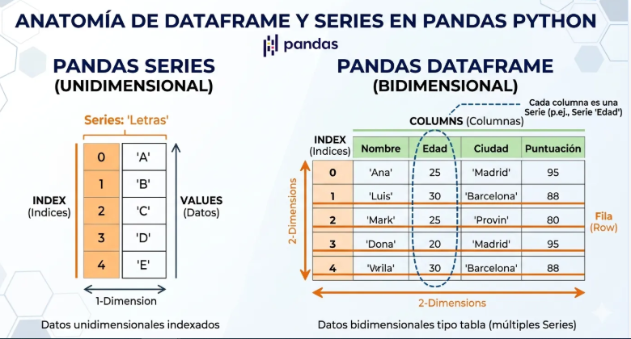
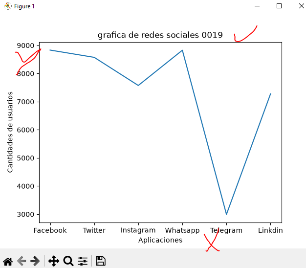
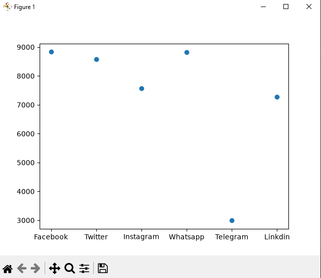
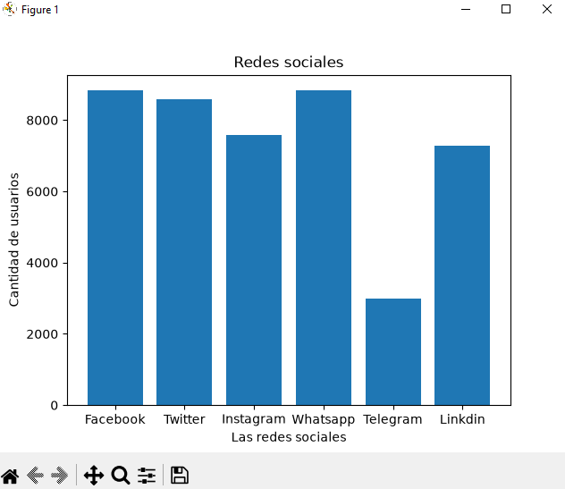
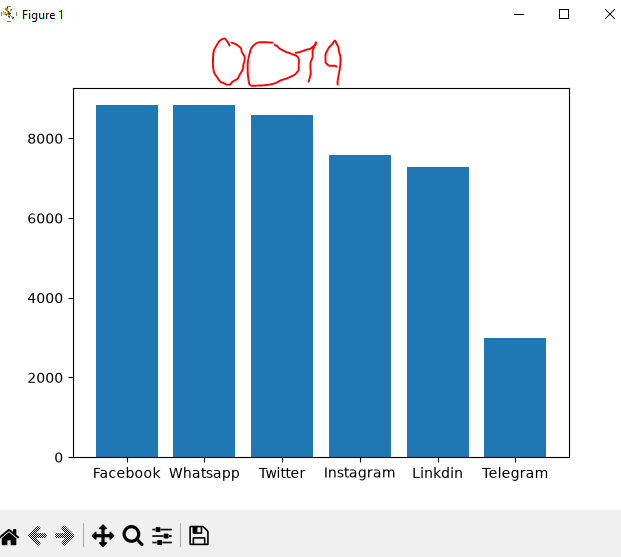
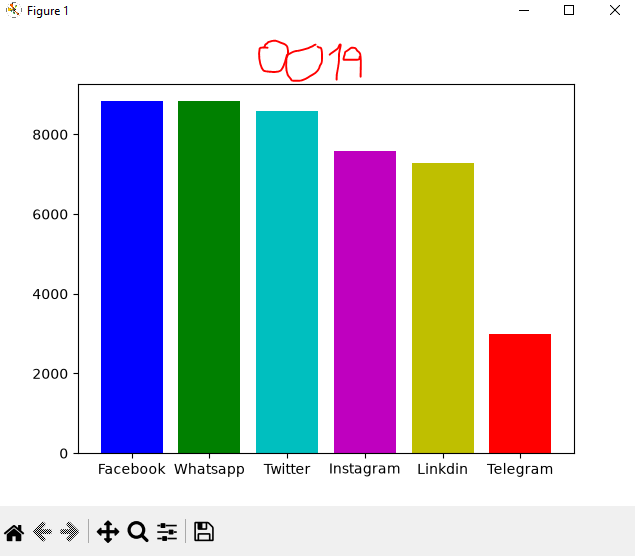
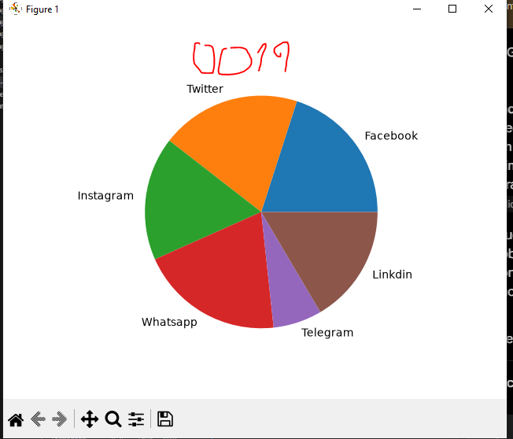

## marco de datos en pandas

## redes sociales a nivel mundial 

## Grafica lineal de redes sociales 

## Grafica puntos de redes sociales 

## grafica de barras de redes sociales 

## grafica de barras descendente 

## Coloriando la grafica 

## grafica de pastel o pie 
